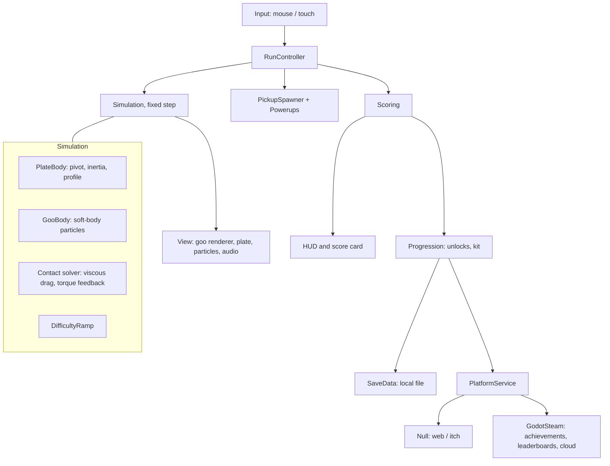

# Architecture

Planned structure as of v0.1.0 (no game code yet). Update with the version whenever it changes.

## Tech

- **Engine**: Godot 4.7.x, GDScript, Compatibility renderer.
- **Targets**: HTML5 (itch.io), Windows, Linux/Steam Deck, macOS (Steam and itch.io downloads).
- **Tests**: GUT, run headless locally and in GitHub Actions.
- **Distribution**: butler (itch.io), SteamPipe (Steam). Credentials only in GitHub Actions secrets.

## Components

## Rules

- The **simulation** is plain GDScript with no scene-tree or rendering dependencies: state in, fixed time step, state out. This is what makes it deterministic and testable headless.
- **View** reads simulation state and never writes to it.
- Kit pieces and powerups are **data** (resources) that modify simulation parameters; adding one needs no new simulation code.
- Only `PlatformService` implementations may reference store SDKs.

## Change log

- v0.1.0: initial planned architecture.
