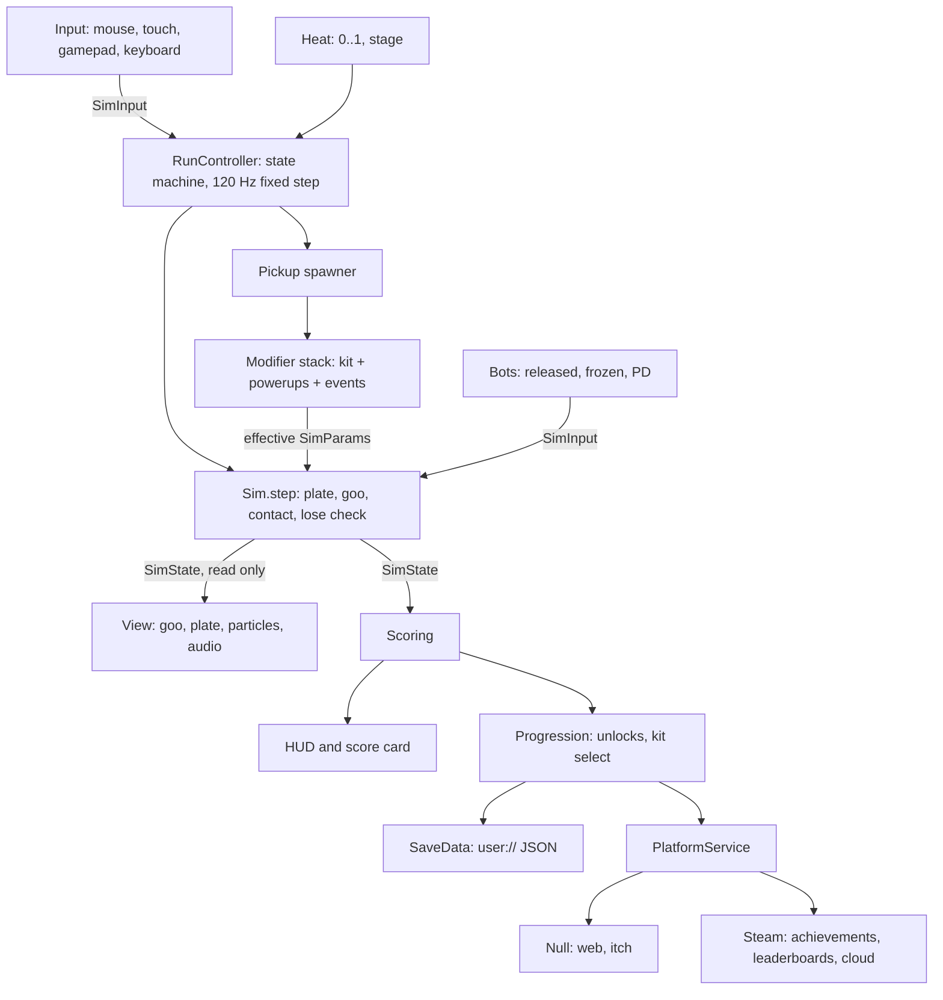

# Architecture

Planned structure (no game code yet). Update with the version whenever it changes.

## Tech

- **Engine**: Godot 4.7.x, GDScript only, Compatibility renderer. Pin the exact patch version in `scripts/get_godot.sh` and record it in `CLAUDE.md`.
- **Targets**: HTML5 (itch.io, and GitHub Pages for playtests), Windows, Linux/Steam Deck, macOS.
- **Tests**: GUT, headless, locally and in GitHub Actions.
- **Distribution**: butler (itch.io), SteamPipe (Steam). Credentials only in GitHub Actions secrets.

## Layout

```
project.godot
src/sim/        pure simulation: sim_params.gd, sim_state.gd, sim_input.gd, sim.gd, plate_profile.gd, bots.gd
src/game/       run_controller.gd, heat.gd, scoring.gd, pickups, powerup stack, kits, save_data.gd
src/view/       goo renderer, plate, particles, audio hooks
src/ui/         HUD, score card, menus, kit select, tuning panel
src/platform/   platform_service.gd, null_platform.gd, steam_platform.gd
src/data/       resources: kits/, pickups/, default sim params
assets/         art, audio, fonts, CREDITS.md
tests/          GUT tests (tests/unit/...), shell and Python tool tests
addons/gut/     vendored test framework
tools/          reference_sim.py (reference prototype, not shipped)
scripts/        get_godot.sh, run_tests.sh, sim_report.sh, tag_release.sh
store/          itch/ and steam/ page text and screenshots
```

## Components



## Rules

- **`src/sim/` is pure**: plain GDScript objects, no Node, scene-tree, rendering, `Input`, `Time` or global random calls. State in, `SimInput` in, fixed time step, state out. Randomness comes from a seeded generator stored in the state.
- **View reads simulation state and never writes to it.**
- **Kit pieces, powerups and events are data** that produce multipliers on `SimParams` through one modifier stack. Adding one needs no new simulation code. When all modifiers are removed the effective parameters equal the base exactly.
- **Only `src/platform/` may reference store SDKs.**
- **All user-visible strings go through `tr()`.**

## Simulation spec

`tools/reference_sim.py` implements this spec in about 200 lines of standard-library Python and is the reference when porting. If prose and reference disagree, the reference wins; fix the prose.

### World
- Units: 1 world unit = 120 px at 1920x1080 (visible area 16 x 9 units). x right, **y down**. The pivot is the origin of simulation space; the view places it at screen (8, 5.5).
- Fixed tick `dt = 1/120 s`, 4 constraint iterations per tick. Rendering interpolates between the last two states. At most 8 ticks per rendered frame.
- Plate angle `theta` > 0 means the right rim is lower. Plate-local to world: `(x cos - y sin, x sin + y cos)`.
- Torque of force F at point r (about the pivot): `r.x * F.y - r.y * F.x`. Velocity of a plate point r: `omega * (-r.y, r.x)`.

### Plate surface
- Local profile for |x| <= W: `surf(x) = -crown * (1 - (x/W)^2)` (the centre is higher than the rim by `crown`). With a lip, for |x/W| > 0.92 subtract `lip * (|x/W| - 0.92) / 0.08`.

### One tick
1. **Plate**. `torque = goo_torque_from_previous_tick - ang_damp * omega`. If grabbing: grab point `r = to_world(grab_x, surf(grab_x))` (grab_x fixed at press, clamped to the plate); `F = k_grab * (cursor - r) - c_grab * velocity_of(r)`, length clamped to `f_max`; add `torque(r, F)`. Then `omega += torque / inertia * dt; theta += omega * dt`; if |theta| > `theta_max`, clamp and set omega to 0.
2. **Goo** is a closed ring of `n` particles of equal mass. Predict: `pos' = pos + (vel + a * dt) * dt` with `a = (wobble + wind, g)`. Then, per iteration:
   a. **Skin**: for each neighbour pair, move both to restore the rest edge length `L0 = 2 * r0 * size * sin(pi / n)`.
   b. **Volume**: polygon area A, target `fill * pi * (r0 * size)^2`. Gradient for particle i is `0.5 * (p[i+1].y - p[i-1].y, p[i-1].x - p[i+1].x)`; `lambda = -(A - target) / sum(|grad|^2)`; `p[i] += lambda * grad[i]`.
   c. **Firmness** (skipped when 0): shape-match to the rest circle scaled by `size`: best-fit rotation by `atan2`, then `p[i] += firmness * (goal[i] - p[i])`.
   d. **Plate collision**, one-sided: convert the particle to plate-local q. If |q.x| <= W and `0 < q.y - surf(q.x) <= thick`, move it to the surface at the same local x. Remember the total collision correction and the local x of each touching particle. Particles beyond the rim or below the slab fall freely.
3. **Velocities and contact**. `vel = (pos' - pos) / dt`. For each touching particle: take the velocity relative to the plate point under it, and multiply its component along the surface tangent by `exp(-drag * dt)`. **There is no static friction and no threshold.** Contact impulse on the particle `J = m_i * (collision_correction / dt + tangential_velocity_change)`; the plate receives `-J`: `goo_torque += -torque(r, J) / dt`.
4. **Lose check**: lost when the goo centroid's y is greater than the lower rim's world y plus `lose_margin`.

Wobble is a sum of three sines of time with seeded phases (see the reference), scaled by the wobble amplitude.

### Parameters (starting values, validated in the reference)

| Name | Value | Meaning |
|---|---|---|
| g | 9.8 | Gravity, units/s^2 |
| W | 3.0 | Plate half-width |
| crown | 0.20 | Height of the centre above the rim |
| thick | 0.30 | Collision slab thickness |
| inertia | 6.0 | Plate rotational inertia |
| ang_damp | 1.5 | Plate angular damping |
| theta_max | 0.70 | Tilt limit, radians |
| lip | 0 | Raised rim height (kit, Rim Guard: 0.15) |
| k_grab, c_grab, f_max | 60, 8, 80 | Grab spring stiffness, damping, force limit |
| n | 28 | Goo particles |
| mass | 1.0 | Goo mass (light compared with the plate) |
| r0 | 0.70 | Radius of the rest circle (sets skin length) |
| fill | 0.65 | Area target as a fraction of the rest circle: below 1 gives a puddle |
| firmness | 0 | Shape stiffness per iteration; Firm Up uses 0.01 |
| lose_margin | 0.75 | Distance below the lower rim that counts as fallen |
| cap | 180 | Session cap, seconds |

Ramp, linear in heat `h = t / cap`:

| Quantity | h = 0 | h = 1 |
|---|---|---|
| drag (grip rate, 1/s) | 2.0 | 0.1 |
| size (scale) | 1.0 | 1.5 |
| wobble amplitude (units/s^2) | 1.0 | 9.0 |

### What the reference measured (2026-11-14, defaults above)

| Scenario | Result |
|---|---|
| Resting shape, heat 0 | 1.89 wide x 0.70 tall, 11 of 28 particles touching |
| Hands off, heat 0 | loses in 2.7-3.0 s |
| Frozen hand, heat 0 | loses in 4.3-6.0 s |
| Easiest kit combination (tacky, gentle crown 0.12, heavy, wide) | 3.1-3.5 s hands off, 5.0-6.6 s frozen |
| Rimmed + tacky + heavy | 3.0-3.4 s hands off, 4.4-6.2 s frozen |
| Bot novice (delay 0.35 s) | survives 75-85 s |
| Bot average (delay 0.25 s) | survives 113-127 s |
| Bot expert (delay 0.12 s) | survives 152-164 s; none reached the cap |

Lessons from the prototype:
- Constant shape-matching stiffness of even 0.003 per iteration made a near-rigid ball. Default firmness is 0.
- The first ramp (drag 3.0 -> 0.5, wobble 0.3 -> 2.0) let the slowest bot survive about 170 s. The current ramp is much harsher.
- Bots are steadier than people; expect human times well below bot times. Human targets are set at the fun gate (PLAN item 12).
- A low lip barely changes the hands-off result at this wobble level. Check at item 19 that each kit piece really helps the bots.

### Performance budget
- 120 ticks in under 150 ms headless on the CI runner (GDScript, `PackedVector2Array`). If over budget, reduce `n` to 24 before anything else.

## Testing strategy

| Layer | What | Where |
|---|---|---|
| Unit | Plate, goo, contact, scoring, save, modifiers | GUT, `tests/unit/` |
| Design invariant | Hands-off and frozen-hand losses for every kit combination | GUT, uses `bots.gd` |
| Difficulty regression | Bot survival bands, frozen after the fun gate | GUT + `scripts/sim_report.sh` |
| Determinism | Same seed and inputs -> identical state | GUT |
| Tooling | Tag script, reference sim check | shell and Python in CI |
| Human | Feel, readability, fun | Playtest build on GitHub Pages at the gates |

## Tuning

Record every change to a parameter here: date, version, parameter, old -> new, reason, and the bot report after the change.

| Date | Version | Change | Reason |
|---|---|---|---|
| 2026-11-14 | 0.1.1 | Starting values set from the reference prototype | See "What the reference measured" |

## Change log

- v0.1.1: simulation spec, parameter table, layout, testing strategy; reference prototype added.
- v0.1.0: initial planned architecture.
